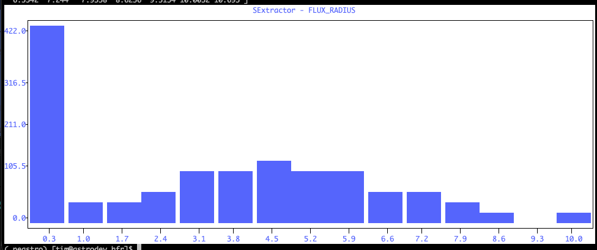

# HFR Extaction and display 

Purpose: I would like to try and get my guiding somewhat better,  as within EKOS the HFR values can be used in the guiding algorithm. 

Now it is possible to see the HFR inside kstars/already (Fits viewer, Show Stars) - but this means you need to manually look, and keep track of the HFR. That will not work in the long term. 

## Sextractor 

Sextractor is areal *old-school* piece of code, which you can tell has been made to process 000's of images - in varying ways.  Sadly not seen much at command level these days - but a lot of guiding still appears to use this code base. 

It is **VERY** configurable, but as it feels more like software from the Fortran days (f77 anyone ?) - it probably has lost it's appear to some people. 

It compiles nicely, allowing many customizations to its operating parameters.

### Installing 

I  build all my code from scratch ... and this code is no exception. 

   cd ~/Dev/C++/Astro # Or where you do this stuff 
   git clone https://github.com/astromatic/sextractor.git
   cd sextractor 

Building is very standard 

```bash
./autogen
./configure --enable-openblas --with-fftw-incdir=/usr/include --with-fftw-libdir=/opt/lib --disable-model-fitting
make -j4
sudo make install 
``` 

## Adding a HFR-Esque option. 

Please note.. FLUX_RADIUS could refer to 
   - HFR (Half Flux Radius)
   - HFD (Hald Flux Diameter) 

The documentation states 

```text
In SExtractor, FLUX_RADIUS is an output parameter that provides the radius of a circle (centered on the object's centroid) that encloses a specified fraction of an object's total flux
```

This value appears to be configurable using **PHO_FLUXFRAC** and other variables - but these considerations are considered out of scope, for this project.


## Making HFR files 

*Sex* is a file based engine, so that means to do something like *extract the HFR/Flux Radius* you will need some specific files. 

These files are provided in this git repo. It is that simple.

# Command line activate 

However you will need someway to make this a shortcut. So on Linux/Mac you will need an alias 

    alias hf='sex -c /home/tim/hfr/hfr.sex -PARAMETERS_NAME /home/tim/hfr/hfr.param'

You should place this in your login shell auto file typically either (~/.bashrc or ~/.zshrc)

# Running 

Assume I saved a FITS file to */home/tim/test/img_01.fits* 

In a command shell windows I just type 

    hf /home/tim/test/img_01.fits 

And nothing happens !!
Because *sex* is file based, and the output of the command was placed in a file defined in **hfr.sex** specifically 

    CATALOG_NAME     /home/tim/hfr/hfr.cat 

If we type(cat) this file 

    cat /home/tim/hfr/hfr.cat 

I see 

```text
#   1 X_IMAGE                Object position along x                                    [pixel]
#   2 Y_IMAGE                Object position along y                                    [pixel]
#   3 MAG_BEST               Best of MAG_AUTO and MAG_ISOCOR                            [mag]
#   4 FLUX_RADIUS            Fraction-of-light radii                                    [pixel]
#   5 FLUX_AUTO              Flux within a Kron-like elliptical aperture                [count]
  3362.7808     61.8751 -12.5637      6.110     106045.6
  3225.0249     46.4021 -12.4065      8.690     91751.91
  1699.7313     49.8356 -12.3115      7.589     84063.54
  1930.4434     27.3749 -11.7665      6.379        50886
  3397.0000     22.4877 -12.0962      7.121     68939.02
  1209.0000     28.5097 -11.9503      3.317     77545.26
  1210.0000     19.9593 -11.9224      3.663     80039.63
  2811.0000     17.2342 -11.1899      4.675     42002.38
```


I had requested 5 fields, the 4th one being the FLUX_RADIUS. 

## Visually see this data  

I am still in command line - in a terminal. 

I run a python script called **graph.py** like this 


    python graph_hfr.py 

and I see 




**PLEASE NOTE: This is command line graph**


**NOTE**: python needs 2 modules ... installed with 

    pip install -r requirements.txt


You can of course blend all this together - but by now you should have way of extraction and analyzing data very painlessly from fits data, in a terminal window. 


